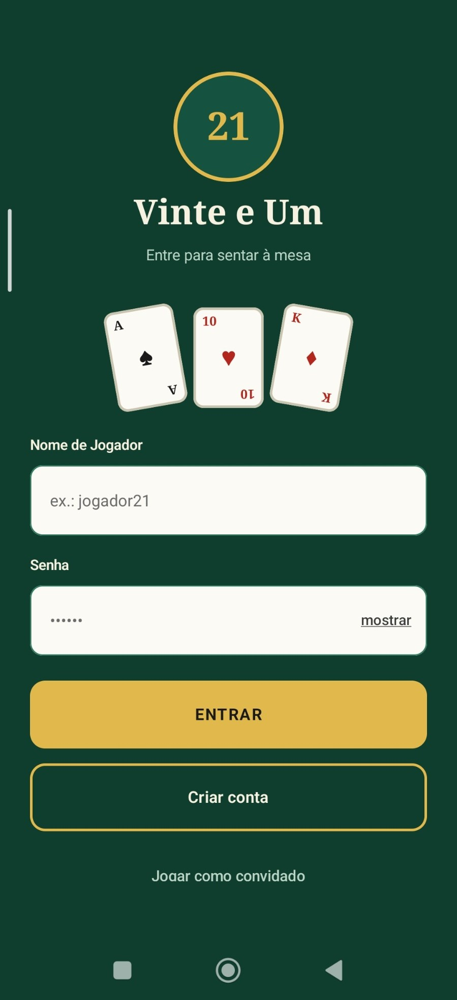
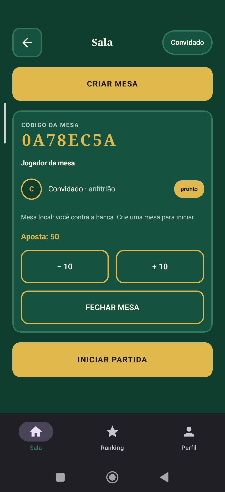
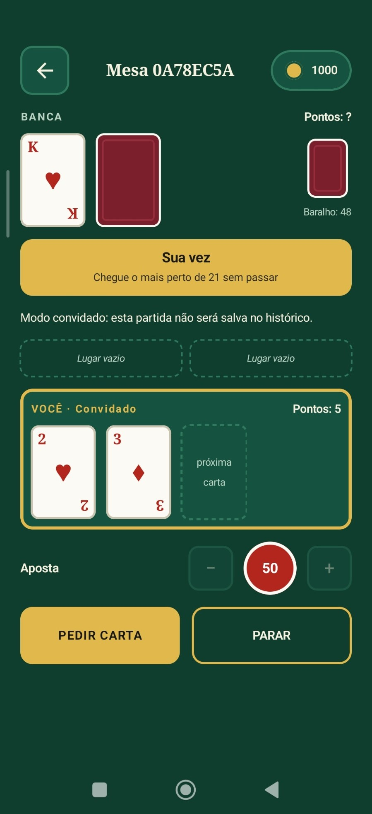
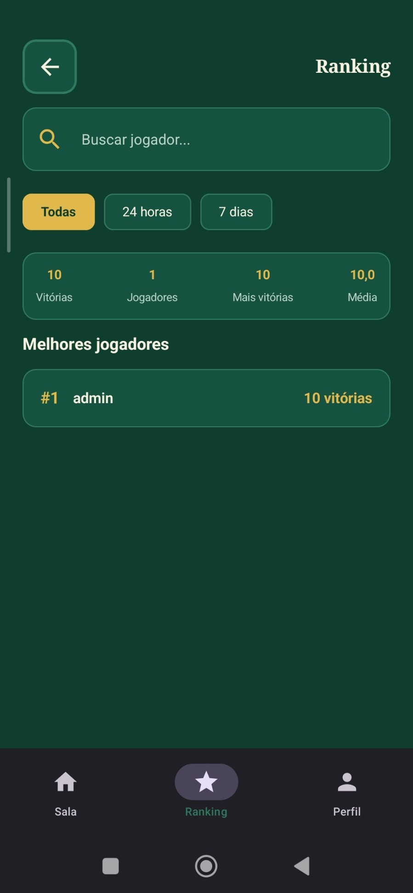

# CardGame21

[License](#licença--license) | [Screenshots](#capturas-de-tela--screenshots)

## Português

[English](#english)

O **CardGame21** é um jogo de Blackjack (21) para Android que fizemos em equipe no curso de Análise e Desenvolvimento de Sistemas da Universidade Positivo. A proposta era criar um jogo simples e, ao mesmo tempo, colocar em prática o que aprendemos sobre desenvolvimento Android.

### O que tem no jogo

- Cadastro, login e modo convidado.
- Mesa local, apostas com fichas virtuais e partidas contra a banca.
- Saldo salvo para jogadores cadastrados (inicialmente, 1.000 fichas).
- Ranking por vitórias, com busca por nome, filtros e detalhes das partidas.
- Área de administrador para editar e excluir jogadores e registros de partidas.

As fichas são apenas virtuais: não há apostas com dinheiro real nem multiplayer online (por enquanto).

### Tecnologias e dependências

As dependências já estão configuradas em `app/build.gradle.kts` e `gradle/libs.versions.toml` e são gerenciadas automaticamente pelo Gradle.

- **Kotlin e Coroutines:** linguagem e operações assíncronas.
- **Jetpack Compose e Material 3:** telas e componentes visuais.
- **Navigation Compose:** navegação entre as telas.
- **ViewModel (AndroidX), Flow e StateFlow:** lógica e atualização dos estados da interface.
- **Room (Runtime e KTX) + KSP:** banco de dados local.
- **Retrofit e Gson Converter:** comunicação com a API e leitura do JSON.
- **JUnit, AndroidX Test e Espresso:** testes unitários e instrumentados.

Seguimos o padrão **MVVM**, separando telas, ViewModels, repositórios e fontes de dados.

### API e armazenamento

A [Deck of Cards API](https://deckofcardsapi.com/) fornece um baralho embaralhado de 52 cartas no começo de cada rodada. Se a requisição falhar, o jogo usa um baralho local. O **Room** guarda jogadores, saldos e histórico de partidas no dispositivo.

### Como executar

Você precisa do **Android Studio**, do SDK Android e de um dispositivo ou emulador com **Android 7.0 (API 24)** ou superior.

`git clone https://github.com/pazucch/CardGame21.git`

Abra a pasta no Android Studio, sincronize o Gradle e execute o módulo `app`.

**Para rodar os testes:**

```bash
./gradlew testDebugUnitTest
./gradlew connectedDebugAndroidTest
```

No Windows, use `.\gradlew.bat`. Os testes instrumentados precisam de um dispositivo ou emulador conectado.

### Equipe

[pazucch](https://github.com/pazucch) · [VonRyn](https://github.com/VonRyn) · [Ellyvc23](https://github.com/Ellyvc23) · [andreguerraa](https://github.com/andreguerraa)

---

## English

[Português](#português)

**CardGame21** is an Android Blackjack (21) game we built as a team project for our Systems Analysis and Development course at Universidade Positivo. We wanted something fun to play while practicing Android development along the way.

### What's in the game

- Sign-up, login, and guest mode.
- Local tables, virtual-chip bets, and games against the dealer.
- Saved balances for registered players (starting at 1,000 chips).
- A wins leaderboard with player search, date filters, and game details.
- An admin area to edit and delete players and game records.

Chips are virtual only. There's no real-money betting or online multiplayer.

### Tech stack and dependencies

All dependencies are already configured in `app/build.gradle.kts` and `gradle/libs.versions.toml` and are automatically managed by Gradle.

- **Kotlin and Coroutines:** app logic and asynchronous work.
- **Jetpack Compose and Material 3:** screens and UI components.
- **Navigation Compose:** navigation between screens.
- **ViewModel (AndroidX), Flow, and StateFlow:** app logic and reactive UI state.
- **Room (Runtime and KTX) + KSP:** local database.
- **Retrofit and Gson Converter:** API requests and JSON parsing.
- **JUnit, AndroidX Test, and Espresso:** unit and instrumented tests.

We use **MVVM** to keep screens, ViewModels, repositories, and data sources separate.

### API and local data

At the start of each round, the app gets a shuffled 52-card deck from the [Deck of Cards API](https://deckofcardsapi.com/). If the request fails, it switches to a local deck. **Room** stores players, chip balances, and game history on the device.

### Running the app

You'll need **Android Studio**, the Android SDK, and a device or emulator running **Android 7.0 (API 24)** or newer.

`git clone https://github.com/pazucch/CardGame21.git`

Open the project in Android Studio, sync Gradle, and run the `app` module.

**To run the tests:**

```bash
./gradlew testDebugUnitTest
./gradlew connectedDebugAndroidTest
```

On Windows, use `.\gradlew.bat`. Instrumented tests require a connected device or emulator.

### Team

[pazucch](https://github.com/pazucch) · [VonRyn](https://github.com/VonRyn) · [Ellyvc23](https://github.com/Ellyvc23) · [andreguerraa](https://github.com/andreguerraa)

---

## Capturas de tela / Screenshots

<p align="center">
  
  
  
  
</p>

<p align="center"><sub>Login · Sala/Table · Partida/Game · Ranking</sub></p>

---

## Licença / License

[MIT](LICENSE.md)
